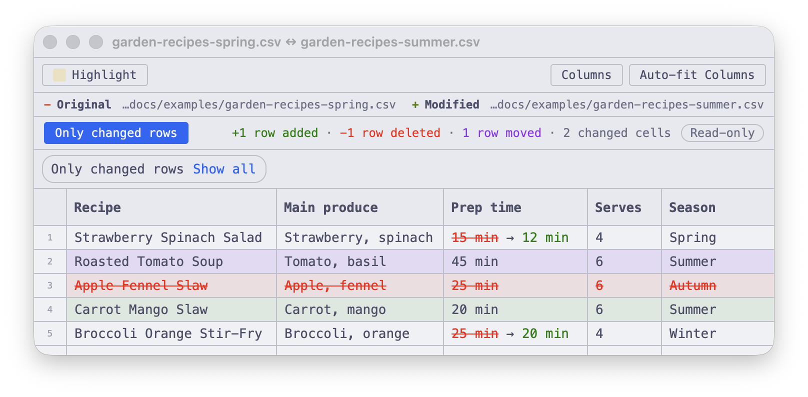
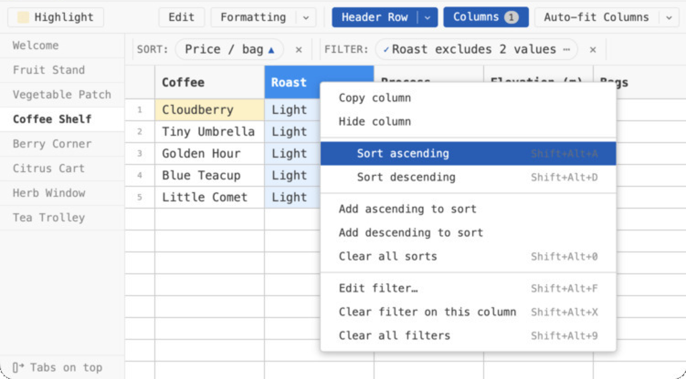

# Table Viewer

查看与对比电子表格、数据表及数据集，并支持常见格式的编辑功能。



Table Viewer 支持编辑新版 Excel（`.xlsx`）、`.csv` 和 `.tsv` 文件，并支持对旧版 Excel（`.xls`）工作簿、Stata（`.dta`）数据集和 Parquet（`.parquet`）文件进行只读查看和差异对比。它专为审阅、探索、对比和标注表格数据而设计，提供独立桌面应用和 VS Code 扩展两种版本。

你在查看表格时所做的操作——排序、筛选、隐藏列、调整宽高、高亮单元格——都会保存在文件旁侧而非文件内部，因此磁盘上的原文件不会被改动；下次打开时，你的排序、筛选和高亮设置依然保留，即使原文件在此期间被重新生成也不受影响。当磁盘上的文件发生变化时，Table Viewer 也会自动重新加载。



按照[安装与 10 分钟快速上手指南](docs/setup-guide.md)选择独立桌面应用或 VS Code 扩展，完成安装并体验两个示例工作簿，看看 Table Viewer 如何在文件被替换后依然保留已保存的视图。

## 安装

### Visual Studio Code 扩展

从编辑器对应的扩展市场安装 Table Viewer：

- **Visual Studio Code：** 打开 [Visual Studio Marketplace 上的 Table Viewer](https://marketplace.visualstudio.com/items?itemName=jbearak.table-viewer) 并点击 **Install**。
- **使用 Open VSX 的编辑器：** 打开 [Open VSX 上的 Table Viewer](https://open-vsx.org/extension/jbearak/table-viewer) 并点击 **Install**。

你也可以打开编辑器的 **Extensions**（扩展）视图，直接搜索扩展 ID `jbearak.table-viewer`。安装完成后，打开任意 `.xlsx`、`.xls`、`.csv`、`.tsv`、`.dta` 或 `.parquet` 文件，Table Viewer 会自动注册为这些文件类型的编辑器。

### macOS 桌面应用

桌面应用需要搭载 Apple Silicon（M1 及以上）芯片并运行 macOS 12 或更高版本的 Mac。可通过 Homebrew 安装：

```sh
brew install --cask jbearak/table-viewer/table-viewer
```

或者通过磁盘映像（DMG）安装：

1. 打开[最新发布页面](https://github.com/jbearak/table-viewer/releases/latest)并展开 **Assets**。
2. 下载 `table-viewer-<version>-arm64.dmg`。这是 macOS 安装包；名称相近的 `.zip` 和 `latest-mac.yml` 文件供自动更新程序使用。
3. 打开 DMG，将 **Table Viewer** 拖入 **Applications**（应用程序）文件夹，然后从应用程序或 Spotlight 启动。

### Windows 桌面应用

桌面应用需要 Windows 10 或 11。打开[最新发布页面](https://github.com/jbearak/table-viewer/releases/latest)，展开 **Assets**，下载以下四个文件之一。免安装版（No-install version）为单个 `.exe` 文件，无需安装即可直接运行：

| 你的电脑架构 | 标准安装版 | 免安装版 |
|---|---|---|
| 大多数 Intel 或 AMD 电脑 | `table-viewer-<version>-x64-setup.exe` | `table-viewer-<version>-x64-portable.exe` |
| Arm 架构电脑（如骁龙本） | `table-viewer-<version>-arm64-setup.exe` | `table-viewer-<version>-arm64-portable.exe` |

除非明确需要免安装版，否则建议选择 `setup.exe`。安装向导会创建开始菜单快捷方式、注册 **打开方式**（Open with）关联，并默认采用无需管理员权限的当前用户安装。免安装版 `.exe` 不会创建开始菜单项或卸载入口，但同样会保存 Table Viewer 设置并注册当前用户的 **打开方式** 关联。如果不确定电脑架构，可打开 **设置 → 系统 → 系统信息** 查看 **系统类型**。

运行下载的 `.exe` 文件。由于 Windows 构建版本未签名，首次运行时 SmartScreen 可能会显示 **Windows 已保护你的电脑**（Windows protected your PC）；点击 **更多信息**（More info），确认应用为 Table Viewer 后，点击 **仍要运行**（Run anyway）即可。发布页面中的 `.blockmap` 和 `.yml` 文件为更新元数据，并非安装程序；`.sha256` 文件为可选校验和，用于验证下载完整性。

## 为什么开发它

平时制作表格时，我通常用代码生成——R、Stata、Python——并通过反复运行脚本来调整结果。其余与表格打交道的时间则主要用于阅读：审阅自己或同事用程序生成的输出，或是别人发来的表格。Excel 和 Numbers 是为手工编制电子表格而设计的，在这两种工作流下几乎每一步都会带来额外阻力。

我最初创建 Table Viewer 的原因，就是为了减轻反复迭代生成工作簿时的痛苦。在 Excel 或 Numbers 中，每次重新运行脚本都意味着要关闭文件、重新打开、重新定位到刚才的位置，还要重新设置高亮、列宽等状态。Table Viewer 打开迅速，文件变更时会自动重载，并在跨重载和跨会话时保留你的滚动位置、列宽、隐藏列、排序、筛选以及当前活动工作表。

它还消除了阅读表格时的其他痛点：

- **CSV 和 TSV 文件可能超过 Excel 的 1,048,576 行工作表限制。** Table Viewer 默认最多显示一百万行；当文件超过该限制时，你可以调高上限或为当前文件选择 **Load all rows**（加载所有行）。它会对文件建一次索引，并按需分页解析行数据供网格渲染。
- **排序、筛选和隐藏会修改工作表本身。** 在审阅输出结果时，你最不希望的就是改动原数据。在 Table Viewer 中，这些都是纯视图层面的变换：磁盘上的文件永远不会被修改，也无需额外步骤将区域转换为可排序/筛选的列表——每一列天生就支持排序和筛选。
- **导出的报表常常在真正的数据表上方带有标题和注释。** 右键点击实际的表头行——哪怕它位于好几行之后——选择 **Use row as header**（将此行设为表头）。Table Viewer 会隐藏上方的前导行，将该行提升为列标题，记住你的选择，并能处理常见的两行纵向合并表头标签。
- **无法轻松控制文件打开时的呈现样式。** 字体、字号、配色——Table Viewer 允许你在偏好设置中一次性设定，之后打开的每一张表都会遵循这些设置，打开即清晰易读。
- **单元格格式可能会遮盖需要审计的真实数值。** 无需修改工作簿，即可在工作簿的格式化显示与底层原始单元格值之间一键切换。
- **内容溢出的单元格往往需要调整行高列宽**，而这常会让表格变得难看。在 Table Viewer 中，鼠标悬停即可通过提示框查看完整显示值。
- **高亮单元格需要穿过层层格式菜单。** 在这里只需右键点击单元格并选择颜色即可。高亮属于标注而非格式：它们会在保存、重载和文件替换后依然保留。
- **多工作表的工作簿很难操作：** 当底栏工作表标签溢出时，Excel 里甚至无法滚动——只能点击左右按钮翻找。Table Viewer 的工作表标签支持滚动，并且可以设为纵向排列。
- **远程文件必须先下载到本地。** 作为 VS Code 扩展，Table Viewer 通过 SSH 远程打开文件与本地体验完全一致，并使用你编辑器的主题和字体。
- **在 Git 中对比电子表格只能看到一堵文本墙。** 在 VS Code 的源代码管理（Source Control）或时间线（Timeline）视图中点击已修改的 `.xlsx`、`.xls`、`.csv`、`.tsv`、`.dta` 或 `.parquet` 文件，Table Viewer 会以表格形式打开对比视图：新增和删除的行带有色带标识，修改的单元格会在原地同时显示修改前后的值。桌面应用也支持任意两个文件的对比。
- **对比 Git LFS 文件时只能看到指针，看不到表格。** 受 LFS 追踪的文件在 Git 中存为指向真实对象的小指针文件，因此要对比的版本往往并不在本地机器上。Table Viewer 能识别对比任意一侧的 LFS 指针，并提供下载真实对象的选项。

**局限性：** Table Viewer **并非**完整的电子表格编辑器。你无法新建文件或新建工作表。你可以在 `.xlsx`、CSV 和 TSV 工作表中插入、删除和移动行与列，但如果 `.xlsx` 工作表包含 Excel 表格（Excel table）、图表、批注（notes）、数据透视表或数组公式，则无法进行结构调整；详见[插入、删除和移动行与列](docs/rows-and-columns.md)。公式编辑与重算仅有意支持 Excel 公式的一个已文档化子集；详见[Excel 公式支持](docs/excel-formulas.md)。

## 功能特性

**查看**
- 打开 `.xlsx`、`.xls`、`.csv`、`.tsv`、`.dta` 和 `.parquet` 文件
- 多工作表工作簿支持横向或纵向标签页布局
- 支持合并单元格的跨列/跨行（colspan/rowspan）渲染
- 支持 `.xlsx` 富文本片段以及整格加粗、斜体、下划线和删除线样式
- 支持 `.xlsx` 超链接，悬停显示目标地址信息，外部链接支持打开与复制操作
- 保守自动检测 Excel 列名行，提供按工作表记忆的控件以将首行非隐藏行或指定行提升为表头，包括继承自简单两行纵向合并的列名
- 将激活的 Excel 表头行用作逻辑表，支持诸如 `=SUM([Revenue])` 和 `=[@Revenue]*2` 的公式，无需事先定义 Excel 表区域
- 鼠标短暂停留在水平截断或垂直裁剪的单元格内容上时，通过提示框显示完整的显示值
- 鼠标悬停在 Stata 或 Parquet 列头上时，显示变量标签、类型和值标签集；对于 Parquet，还会显示来自文件 footer 的空值计数（null count）和取值范围
- 稳定的多列排序，缺失值始终排在最后
- 支持每列按文本、比较条件、范围、唯一值复选框列表以及空/非空值进行筛选

**自动刷新**
- 监听磁盘上的文件变化并在修改后自动重新加载
- 跨重载保留列宽、行高、滚动位置和当前活动工作表

**布局**
- 拖拽列边界与行边界以调整大小
- 双击列边界以自适应内容宽度
- 通过行号选中连续或不连续的多行，拖拽其中任一选中行的边界即可同步调整行高
- 选中多列即可同步调整列宽或批量自适应宽度
- 使用带搜索功能的 **Columns**（列）菜单显示、隐藏、恢复或隐藏全部列
- 列的可见性与尺寸按文件和工作表维度持久化保存

**格式化切换**
- 一键在格式化显示值与原始单元格值之间切换
- 便于核查格式化显示背后的精确数值

**表格差异对比（Diff）**
- 在只读表格视图中对比两个 Excel、Stata、Parquet、CSV 或 TSV 文件——不会修改任一原文件
- 清晰展示新增、删除、移动和修改的行，并在修改的单元格内高亮显示修改前后的值
- 对齐插入、删除和移动的行，避免因单次结构变动导致后续所有行看起来都被修改
- 可选的 **Only changed rows**（仅显示变更行）开关可隐藏两个文件中完全相同的行
- 在 VS Code 中，点击源代码管理（Source Control）或时间线（Timeline）视图中发生变更的表格文件即可打开差异对比——未暂存、已暂存和已提交的变更均支持
- 在桌面应用中，选择 **File → Compare Files…**（文件 → 对比文件…）或从最近记录（Recent）列表重新打开对比
- 若对比任一侧的文件存储在 Git LFS 中且尚未下载，系统会自动识别并显示提示横幅，标明对象实际大小并提供拉取按钮

**CSV/TSV 模式**
- **Open as Table**（作为表格打开）：在独立的查看器标签页中打开文件
- **Open Preview to the Side**（在侧边打开预览）：左侧为源码编辑器、右侧为表格的分栏视图，二者支持同步滚动
- 大文件仅建一次索引，随网格请求按窗口分页解析
- 超出配置行数上限的文件会显示横幅，支持修改上限或为当前视图加载所有行

**选择与复制**
- 单击、拖拽或 Shift+单击选择单元格
- 使用方向键导航。在只读文件（`.xls`、`.dta`、Parquet、差异对比、侧边预览）中，也支持 `h`/`j`/`k`/`l` 键导航；在可编辑文件中，直接输入字母即可开始编辑所选单元格
- `Ctrl+C` / `Cmd+C` 将选中单元格复制为制表符分隔（TSV）文本
- 右键上下文菜单支持复制、选择或隐藏行列，以及将某 Excel 行设为表头

**单元格高亮**
- 为选中单元格应用语义高亮颜色作为位置标注，通过工作表、源行号和源列号进行标识
- 高亮在保存、重载、文件内容替换、列名变更以及首行表头切换后依然保留
- 位于暂时不可用行、列或工作表上的高亮仍会被保存，当对应位置恢复时重新出现
- **Clear selection**（清除所选）仅移除所选单元格的高亮；**Clear all**（全部清除）会移除该文件的所有高亮，包括处于不可用行、列或工作表中的休眠高亮
- 只有用户显式执行上述清除操作才会移除高亮
- 与高亮不同，排序和筛选是绑定于表结构（schema）的视图变换，当其所依赖的列结构不再有效时会失效

**撤销与重做**
- `Ctrl+Z` / `Cmd+Z` 撤销上一步更改；`Ctrl+Y` 或 `Cmd+Shift+Z` 重做。在桌面应用的 **Edit**（编辑）菜单中两者均会显示具体对应的操作名称——例如“Undo Paste”、“Redo Clear all highlights”——无可操作项时呈置灰状态
- 覆盖范围包括单元格编辑（值、换行、样式、超链接）、插入/删除/移动行列、单元格高亮以及放弃更改（Discard）。**Discard**（放弃更改）也可完整撤销
- 每个工作簿共用一条按操作顺序记录的历史栈：跨工作表撤销时会自动切换到对应工作表。光标会移动到变更处且区域会短暂闪烁，确保视野之外的撤销操作也清晰可寻
- 撤销可跨过保存操作继续回退，但涉及插入、删除或移动行列的保存操作除外。回退后文件将重新变为未保存状态，需要时可再次保存
- 若变更被当前生效的筛选器或隐藏列遮蔽，撤销/重做仍会正常生效并给出位置提示，避免只见光标静止而不知所踪
- 排序、筛选和列可见性不计入编辑历史——它们属于视图状态，可通过各自的工具栏标签和 **Columns** 菜单进行还原
- 在打开的单元格编辑器**内部**按 `Ctrl+Z` / `Cmd+Z` 执行的是常规文本输入撤销，不会影响工作簿的编辑历史
- 历史记录随窗口存活：关闭标签页、窗口或应用会清空历史。未保存的编辑会被缓存并跨关闭保留，因此重新打开文件时可能会看到无法再撤销的挂起编辑

**查找** — `Cmd+F`（macOS）或 `Ctrl+F`（Windows、Linux），或在桌面应用中点击 **Edit → Find…**
- 输入内容后会从当前选中单元格开始，选中第一个显示文本包含搜索词的单元格；不区分大小写
- `Enter` / `Shift+Enter`（或方向按钮）在工作表内循环跳转至下一个和上一个匹配项；`Escape` 关闭查找栏并保持匹配单元格处于选中状态
- 搜索范围为当前所见的活动工作表：可见列、筛选后保留的行、当前排序顺序，且包含未保存的编辑。匹配基于单元格实际显示的文本，因此 **Formatting**（格式化）开关决定了匹配格式化值还是原始值
- 大文件会逐页读取直至找到下一个匹配项；只有在检查完所有单元格后，查找栏才会显示 **No matches**（无匹配项）

**排序与筛选** — [筛选指南](docs/filtering.md)详细说明了各类筛选条件及其用法
- 右键点击列头可进行升序或降序排序、添加次级排序或打开该列的筛选编辑器
- 已排序列头会显示方向箭头和多列优先级徽章；通过工具栏标签可以反转方向、重排顺序、移除、启用、禁用或编辑已激活的规则
- 针对当前聚焦列的快捷键：`Shift+Alt+A` / `D` 排序，`Shift+Alt+F` 打开筛选，`Shift+Alt+X` 清除该列筛选，`Shift+Alt+0` / `9` 清除全部排序或筛选
- 多个已启用的筛选条件会组合生效，已禁用的筛选条件会保留以便后续重新启用
- 排序和筛选仅作用于视图层，按文件和工作表持久化，并在文件重载后自动重新计算
- 排序和筛选基于原始单元格值而非格式化显示文本进行计算
- 无论升序还是降序，空值始终排在最后
- 当已排序、筛选或隐藏列的工作表包含合并单元格时，视图会临时将其拆分为未合并状态显示。仅原左上角单元格保留合并值，被覆盖的单元格保持为空。恢复原始行序和全部列后，合并布局会精确还原
- 排序、筛选和行隐藏可与编辑功能双向协同：你可以在有未保存更改时进行排序或筛选，也可以在已排序或已筛选的工作表上进行编辑。无论哪种方式，只要存在未保存更改，显示行序都会保持不变以便定位，待保存且文件重载后视图才会反映新值。当某个标签页持有文件的未保存更改时，只有该标签页可以修改该文件的视图；待更改保存或放弃后，展示同一文件的其他标签页即可再次修改视图。同步预览窗格中不支持排序和筛选，它始终按源顺序显示行数据。列可见性在所有模式下均可用

**编辑（`.xlsx`、CSV 和 TSV）**
- 无需切换任何编辑模式。双击单元格、按 **Enter** 或直接输入内容即可开始编辑。**Delete** 清空所选单元格，粘贴操作则向选区写入内容
- 存在未保存更改时，工具栏上的 **Save**（保存）按钮会高亮。其旁会出现 **Discard**（放弃）按钮用于丢弃全部未保存更改，**Diff** 按钮则会把每个被编辑单元格的旧值与新值并排展示
- 在[已文档化的 Excel 公式支持](docs/excel-formulas.md)范围内编辑、复制、剪切并重算 `.xlsx` 公式
- 使用行号底部的 **+** 按钮追加行。向最后一行之后粘贴一块数据时，会自动按整块行数追加，并作为一次可撤销更改记录
- **Enter** 确认编辑并移至下方单元格；若已无下一行，则在末尾追加一行并保持在当前列。**Tab** 按行优先顺序移动，并在最后一行的最后一列触发追加新行
- 挂起的新增行会保留其预期的物理行号，并带有新增行背景色。右键点击挂起行号并选择 **Delete row**（删除行）可移除它；右键点击挂起的删除标记可取消删除
- 右键点击行号或列头可插入、删除、恢复或移动行和列。右键点击单元格同样提供其所在行和列的插入与删除操作。使用 `Alt+Shift+方向键` 可移动选中的行或列，也可以直接拖拽选中的行或列头。在保存前，新增的行列呈绿色，删除的呈红色，移动的呈紫色。**Save** 按钮的悬停提示会说明保存将执行的操作；仅当操作会破坏公式或导致公式引用范围发生与 Excel 不一致的变动时，网格下方才会出现警告提示。详细规则及 `.xlsx` 工作表的限制条件见[插入、删除和移动行与列](docs/rows-and-columns.md)
- 存在激活的排序和筛选时，挂起的新增行会停留在末尾的独立区域中。这些行的 **Hide row**（隐藏行）菜单项仍可见但处于禁用状态
- `Shift+Enter` 或 `Alt+Enter` 在单元格内插入换行符
- `Escape` 取消当前编辑
- `Ctrl+S` / `Cmd+S` 或点击 **Save** 按钮将所有更改写回文件
- 支持使用 Markdown 语法编辑 `.xlsx` 单元格样式：`**粗体**`、`*斜体*`、`<u>下划线</u>` 和 `~~删除线~~`
- 可通过单元格右键菜单添加、编辑或移除指向网页地址或工作簿内部位置的 `.xlsx` 超链接
- 对 `.xlsx` 追加行会增加工作表行，但不会扩大 OOXML Excel 表格（Excel Table）区域。包含 Excel 表格的工作表禁止执行插入、删除和移动行列操作
- 已编辑的单元格在保存前会以不同背景色高亮提示
- 存在未保存更改时，行会保持在当前位置，确保编辑过程中单元格不会从光标下跑掉。你可以先排序或筛选再开始编辑，也可以在编辑过程中添加或更改排序/筛选；两者都不会移动你正在操作的行。即使某行被修改到不再符合当前筛选条件，在保存前它仍保持可见；保存并重载文件后，视图才会更新为新值的结果
- 未保存的更改会被缓存，因此关闭标签页、窗口或应用不会丢失进度
- 如果在存在挂起编辑期间，磁盘文件中的对应单元格发生了变更，界面会弹出提示横幅并将该单元格标记为中性蓝色高亮。点击 **Review changes**（查看变更）可对比原始文件值、当前文件值与你的挂起编辑。你可以跳转到该单元格、忽略提示而不做改动，或者单独放弃该单元格的挂起编辑

**差异对比（Diffing）**

在桌面应用中，选择 **File → Compare Files…**（文件 → 对比文件…），然后分别选择原始（修改前）文件和修改后文件。对比视图为只读，不会改动任一文件。

在 VS Code 中，点击源代码管理（Source Control）或时间线（Timeline）视图中发生变更的 Excel、Stata、Parquet、CSV 或 TSV 文件，Table Viewer 就会打开对比视图。

新增行以绿色色带标注，删除行以红色色带标注，移动行以紫色色带标注。在发生变更的行内，每个被修改的单元格会以红色显示原始值、以绿色显示新值。绿红配色遵循你当前主题的 Git 装饰颜色，与源代码管理视图中新增和删除文件的颜色保持一致。

## 使用方法

**Excel 文件：** 打开 `.xlsx` 或 `.xls` 文件时会自动在 Table Viewer 中打开。新版 `.xlsx` 工作簿支持编辑，旧版 `.xls` 工作簿为只读。当首行高度符合列名特征时，系统会自动将其提升为表头。使用按工作表记忆的工具栏 **Header Row**（表头行）开关可覆盖自动检测结果；启用该开关会将首行非隐藏行提升为表头。

如需选择其他行作为表头，右键点击其行号并选择 **Use row as header**（将此行设为表头）。Table Viewer 会一步完成以下操作：隐藏其上方的行、保留其下方原有的隐藏行状态，并将所选行提升为列名。仅当没有排序或启用的筛选器改变当前行序时，该操作才可用。表头选择与隐藏行状态会按文件和工作表分别记住。

**CSV/TSV 文件：** 打开时会自动在 Table Viewer 中作为可编辑表格打开。标题栏中的 **Open in Text Editor**（在文本编辑器中打开）按钮可切换到 VS Code 内置文本编辑器。当 CSV/TSV 文件在文本编辑器中打开时，编辑器标题栏会出现两个 Table Viewer 按钮：

- **预览图标** 打开与源码双向同步滚动的只读侧边预览（按住 Alt 点击可在同一标签页中打开）
- **表格图标** 重新以可编辑表格视图打开该文件

**Stata 文件：** 自动作为单张只读表格打开。鼠标悬停在列头上可查看变量的标签（label）、存储类型（storage type）、显示格式（display format）和值标签集（value label set）。

**Parquet 文件：** 自动作为单张只读表格打开，按原始存储形式显示日期、时间、时区和 64 位整数。Table Viewer 暂不支持显示的列（如 list 和 struct 类型）会被跳过，并在警告中列出这些列名。详见 [Parquet 文件说明](docs/parquet-files.md)。

## 默认编辑器行为

Table Viewer 会注册为 Excel（`.xlsx`、`.xls`）、Stata（`.dta`）、Parquet（`.parquet`）、CSV 和 TSV 文件的默认编辑器。`.xlsx`、CSV 和 TSV 文件支持编辑；旧版 `.xls` 工作簿、`.dta` 数据集和 `.parquet` 文件为只读。如果系统中还注册了其他查看这些格式的扩展，VS Code 可能会询问你要使用哪个编辑器。

若要以纯文本形式打开 CSV/TSV 文件，可使用表格编辑器标题栏中的 **Open in Text Editor**，或右键点击文件标签页选择 **Reopen Editor With… → Text Editor**。如需更改某种文件类型的默认打开方式，可在同一编辑器选择菜单中点击 **Configure Default Editor**。

## 设置项

Table Viewer 默认沿用 VS Code 的编辑器字体（`editor.fontFamily` 和 `editor.fontSize`）。如果希望表格使用与编辑器不同的字体，可将 `tableViewer.fontFamily` 设为 CSS 字体族值（如 `Hack, monospace`），或将 `tableViewer.fontSize` 设为具体像素大小。

| 设置项 | 默认值 | 说明 |
|---|---|---|
| `tableViewer.fontFamily` | 空（跟随编辑器字体） | 表格视图使用的字体族。留空则跟随 `editor.fontFamily`。 |
| `tableViewer.fontSize` | `0`（跟随编辑器字号） | 表格视图使用的字号（像素）。设为 `0` 则跟随 `editor.fontSize`。 |
| `tableViewer.tabOrientation` | `horizontal` | 工作表标签页的默认排列方向（`horizontal` 水平或 `vertical` 垂直）。可按文件单独覆盖。 |
| `tableViewer.diffOnByDefault` | `false` | 开始编辑时自动开启 **Diff** 开关，使每个被编辑单元格在挂起编辑旁显示将被替换的文件原值。若文件内该单元格发生变化，Diff 会同步更新为最新文件值。可在各查看器的工具栏中单独覆盖。 |
| `tableViewer.maxStoredFiles` | `10000` | 记住布局状态的文件数量上限。超过时按最近最少使用（LRU）原则淘汰旧记录。 |
| `tableViewer.csvMaxRows` | `1000000` | CSV/TSV 文件默认显示的最大行数。超出时会在文件顶部显示横幅，支持修改上限或为当前视图加载所有行。 |
| `tableViewer.maxFileSizeMiB` | `256` | 文件大小阈值（单位 MiB）。超过该大小的文件在打开前会弹窗询问，并提供 **Open Anyway**（仍然打开）选项。 |

## 独立桌面应用

Table Viewer 还可以作为独立的 Electron 桌面应用运行，它复用了相同的查看器、网格和持久化代码——无需安装 VS Code。构建、运行、打包和测试说明请参阅 [desktop/README.md](desktop/README.md)。

macOS 和 Windows 的具体下载地址见上文[安装](#安装)部分。更详细的上手流程、更新机制、校验和验证及故障排查请参阅[桌面应用安装指南](docs/setup-guide-desktop-app.md)。发布维护者可在 [Homebrew tap 指南](docs/homebrew-tap.md)中查看 Homebrew tap 及发布流水线说明。

## 开发指南

克隆仓库后运行 `npm install`。

**VS Code 扩展**（常规流程）：

- `npm run bundle && npm run bundle:webview` — 构建扩展端与 Webview 端打包产物
- `npm test` — 运行 vitest 单元测试
- `npm run test:integration` — 运行 VS Code Extension Host 集成测试
- `npm run package` — 使用 vsce 打包生成 `.vsix`

**桌面应用：**

- `npm run desktop:dev` — 构建产物并使用 Electron 启动应用
- `npm run desktop:package` — 构建本地未签名的 macOS 安装包（dmg + zip，输出至 `dist/desktop-packages/`）
- `npm run desktop:package:win` — 构建 Windows 安装包（setup + portable exe，包含 x64 + arm64）；必须在 Windows 上运行
- `npm run test:desktop-smoke` — 运行 Playwright Electron 冒烟测试（独立于 vitest 测试套件）

`./scripts/setup.sh` 可一次性在本地构建并安装两个前端——将 `.vsix` 安装到 `PATH` 中所有受支持的编辑器，以及（在 macOS 上）将桌面应用安装到 `/Applications`。其参数选项与具体行为详见[开发指南](docs/development.md)。

## 许可证

[GPL-3.0](LICENSE)

第三方致谢（内嵌配色主题及生成后的 npm 包声明位置）请参阅 [NOTICE.md](NOTICE.md)。
