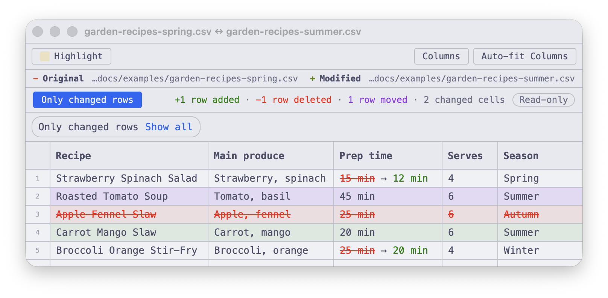

# Table Viewer

Review and compare spreadsheets, tables, and datasets, with editing for common formats.

Table Viewer supports editing modern Excel (`.xlsx`), `.csv`, and `.tsv` files, plus read-only viewing and diffing of legacy Excel (`.xls`) workbooks, Stata (`.dta`) datasets, and Parquet (`.parquet`) files. It is built for reviewing, exploring, comparing, and annotating tables. Available as a standalone desktop app and a VS Code extension.

What you do while reviewing a table — sorting, filtering, hiding columns, resizing, highlighting cells — is stored alongside the file rather than inside it, so the file on disk is untouched and your sorts, filters, and highlights are still there the next time you open it, even if the file was regenerated in the meantime. Table Viewer also reloads on its own when the file changes on disk.

## Getting started

Open an `.xlsx`, `.xls`, `.csv`, `.tsv`, `.dta`, or `.parquet` file and it opens in Table Viewer, which registers as VS Code's default editor for those types. `.xlsx`, CSV, and TSV files are editable; legacy `.xls` workbooks, `.dta` datasets, and `.parquet` files are read-only. If another viewer is registered for one of these formats, VS Code may ask which editor you'd like to use.

To see a CSV or TSV file as plain text, click **Open in Text Editor** in the table's title bar, or right-click its tab and choose **Reopen Editor With… → Text Editor**. The text editor's title bar then has two Table Viewer buttons: the **preview icon** opens a read-only table beside the text that scrolls with it, and the **table icon** opens the editable table again. To change which editor a file type opens in, right-click a tab, choose **Reopen Editor With…**, then **Configure Default Editor**.

The [VS Code setup and 10-minute try-out guide](docs/setup-guide-vscode-extension.md) walks through two sample workbooks, including what happens to your saved view when a file is replaced.

## Compare in Source Control

Click a changed Excel, Stata, Parquet, CSV, or TSV file in the Source Control or Timeline view and Table Viewer opens the comparison as a read-only table. It works for unstaged, staged, and committed changes.

Added rows are banded in green, deleted rows in red, and moved rows in purple. Within a changed row, each changed cell shows its original value in red and the new value in green. The green and red follow your theme's Git decoration colors, so they match the added and deleted files in the Source Control view.

A file stored in Git LFS but not yet downloaded shows a banner with the real size and a button that fetches it.

## Highlights

- [Sorts, filters, and hidden columns](docs/features.md#sorting-and-filtering) change the view, never the file, and are still there the next time you open it.
- When an Excel sheet has titles and notes above the table, right-click the row number beside the real header and choose [**Use row as header**](docs/features.md#opening-files).
- [Highlight cells](docs/features.md#cell-highlights) from the right-click menu. Highlights survive saves, reloads, and a regenerated file.
- [Edit](docs/features.md#editing-xlsx-csv-and-tsv) `.xlsx`, CSV, and TSV cells in place, and insert, delete, and move rows and columns. [Undo](docs/undo-and-redo.md) steps back through edits, row and column changes, sorts, filters, and resizes.
- [CSV and TSV files](docs/features.md#csvtsv-modes) can go past Excel's 1,048,576-row limit. Table Viewer shows a million rows by default and can load the rest.
- Over Remote - SSH it works the same as on a local file, and it uses your editor's theme and font.

## Limitations

Table Viewer is not a full spreadsheet editor. You can't create files or sheets, an `.xlsx` sheet with an Excel table, chart, notes, PivotTable, or array formula can't be [restructured](docs/rows-and-columns.md), and formulas follow a [documented subset of Excel](docs/excel-formulas.md).

## Settings

Table Viewer uses VS Code's editor font (`editor.fontFamily` and `editor.fontSize`) by default. Set `tableViewer.fontFamily` to a CSS font-family value such as `Hack, monospace`, or `tableViewer.fontSize` to a pixel size, if you want tables to differ from the editor.

| Setting | Default | Description |
|---------|---------|-------------|
| `tableViewer.fontFamily` | empty (editor font) | Font family used in table views. Leave empty to follow `editor.fontFamily`. |
| `tableViewer.fontSize` | `0` (editor size) | Font size in pixels used in table views. Set to `0` to follow `editor.fontSize`. |
| `tableViewer.tabOrientation` | `horizontal` | Default worksheet tab orientation (`horizontal` or `vertical`). Can be overridden per file. |
| `tableViewer.diffOnByDefault` | `false` | Turn the **Diff** toggle on when you start editing, so each edited cell shows the file value it would replace beside the pending edit. If that cell changes in the file, Diff updates to the current file value. The setting can be overridden per viewer from the toolbar. |
| `tableViewer.maxStoredFiles` | `10000` | Maximum number of files whose layout state is remembered. Least recently used entries are evicted first. |
| `tableViewer.csvMaxRows` | `1000000` | Rows to display by default for CSV/TSV files. A banner on larger files lets you change the limit or load all rows for that view. |
| `tableViewer.maxFileSizeMiB` | `256` | File-size threshold in MiB. Above it, Table Viewer asks before opening the file and offers **Open Anyway**. |

## Learn more

- The [feature reference](docs/features.md) covers everything Table Viewer does.
- Table Viewer is also a standalone desktop app for macOS and Windows. See [Installation](README.md#installation).
- Report a problem or ask a question in [GitHub issues](https://github.com/jbearak/table-viewer/issues).

## License

[GPL-3.0](LICENSE)

Third-party attributions (the bundled color themes, and where to find the
generated npm package notices): [NOTICE.md](NOTICE.md).
