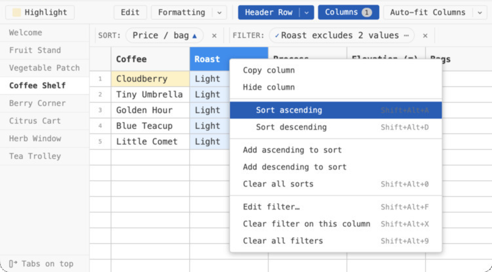

# Table Viewer features

This is the full reference for what Table Viewer does, in both the desktop app and the VS Code extension. Where a feature works differently in one of them, the entry says so. For a guided first look, see the [setup and 10-minute try-out guide](setup-guide.md).

## Opening files

**Excel files** open automatically in Table Viewer when you open an `.xlsx` or `.xls` file. Modern `.xlsx` workbooks are editable; legacy `.xls` workbooks are read-only. When the first row strongly resembles column names, it is promoted automatically. Use the per-sheet **Header Row** toolbar toggle to override the detected choice; enabling it promotes the first non-hidden row.

To choose a different header row, right-click its row number and select **Use row as header**. Table Viewer hides the rows above it, preserves any hidden rows below it, and promotes the chosen row to column names in one step. The action is available only when no sort or enabled filter is changing the displayed row order. Header choices and hidden rows are remembered for that file and worksheet.

You can change the header row while you have unsaved changes. Your edits stay in their cells, deleted rows stay deleted, and appended rows stay at the end. Table Viewer won't change it while the row that would become the header, or the row that is the header now, has unsaved edits, while new columns are unsaved, or while inserted or moved rows would end up under hidden rows. In those cases it says so, and nothing changes until you save.

**CSV/TSV files** open automatically in Table Viewer as an editable table. An **"Open in Text Editor"** button in the title bar takes you to VS Code's built-in text editor. When a CSV/TSV file is open there, two Table Viewer buttons appear in the editor title bar:

- The **preview icon** opens a read-only synced side-by-side preview (alt-click opens it in the same tab)
- The **table icon** opens the file again as an editable table view

**Stata files** open automatically as single read-only tables. Hovering over a column header shows the variable's label, storage type, display format, and value label set.

**Parquet files** open automatically as single read-only tables, with dates, times, time zones, and 64-bit integers shown as they are stored. Columns Table Viewer cannot show, such as lists and structs, are left out with a warning naming them. See [Parquet files](parquet-files.md).

## Default editor behavior

Table Viewer registers as the default editor for Excel (`.xlsx`, `.xls`), Stata (`.dta`), Parquet (`.parquet`), CSV, and TSV files. `.xlsx`, CSV, and TSV files are editable; legacy `.xls` workbooks, `.dta` datasets, and `.parquet` files are read-only. If another viewer is registered for one of these formats, VS Code may ask which editor you'd like to use.

To open a CSV/TSV file as plain text, use **Open in Text Editor** in the table editor's title bar, or right-click its tab and choose **Reopen Editor With… → Text Editor**. To change the default for a file type, choose **Configure Default Editor** from the same editor picker.

## Viewing

- Opens `.xlsx`, `.xls`, `.csv`, `.tsv`, `.dta`, and `.parquet` files
- Multi-sheet workbooks with horizontal or vertical tab orientation
- Merged cells with colspan/rowspan rendering
- `.xlsx` rich-text runs and whole-cell bold, italic, underline, and strikethrough styling
- `.xlsx` hyperlinks, with destination information on hover and open/copy actions for external links
- Conservatively detects Excel column-name rows, with remembered per-sheet controls for promoting the first non-hidden row or a chosen row, including column names inherited from simple two-row vertical merges
- Uses an active Excel Header Row as a logical table for formulas such as `=SUM([Revenue])` and `=[@Revenue]*2`, without requiring an Excel table region
- Hover briefly over horizontally truncated or vertically clipped cell content to see the displayed value in a tooltip
- Hover over a Stata or Parquet column header to see the variable label, type, and value label set, and, for Parquet, the null count and range of values from the file's footer
- Stable, multi-column sorting with missing values kept last
- Per-column filters for text, comparisons, ranges, distinct-value checklists, and empty/non-empty values

## Auto-refresh

- Watches the file on disk and reloads automatically when it changes
- Preserves column widths, row heights, scroll position, and active sheet across reloads

## Layout

- Drag column and row borders to resize
- Double-click a column border to auto-fit to content
- Double-click a row border to fit the row's height to its content, wrapping long text at the column widths. If the row is selected, every selected row is fitted, each to its own height. Rows that are not loaded yet (scrolled far out of view) are skipped with a message
- Right-click a row number and choose **Auto-fit row height** to do the same for the row, or for the selected rows
- Select contiguous or discontiguous rows by their row numbers, then drag a selected row boundary to resize them together
- Select multiple columns, then drag a border of one of them to resize them together. A click on a border that does not move it changes nothing
- **Auto-fit Columns** in the toolbar fits every column of the sheet to its content; pressed again, it puts back the widths the fit replaced. Its menu does either on all sheets: a sheet you have not opened yet is fitted when you open it
- **Auto-fit Rows**, in the same menu, fits every row of the sheet to its content, each to its own height, and is checked while it is on; chosen again, it puts back the heights the fit replaced. It reads every row first, which on a large sheet takes a while: a progress window says how far it has got, and **Cancel** (or `Escape`) stops it with nothing changed. It fits the rows the view shows: rows a filter or a hide leaves out, and rows you have added and not yet saved, keep their heights. It writes nothing if more than 10,000 rows would need a custom height. Like Auto-fit Columns it lasts until the file is reloaded or saved, and another resize of the sheet's rows turns it off
- Right-click a row number and choose **Reset row height** to put the row, or the selected rows, back to the default height
- Use the searchable **Columns** menu to show, hide, restore, or hide all columns
- Column visibility and sizing are persisted per file and sheet

## Formatting toggle

- Switch between formatted and raw cell values with one click
- Useful for inspecting the exact number behind a formatted display

## Table diffs

- Compare two Excel, Stata, Parquet, CSV, or TSV files in a read-only table view — neither file is modified
- See added, deleted, moved, and changed rows, with before-and-after values highlighted within changed cells
- Aligns inserted, deleted, and moved rows so one structural change does not make every later row look modified
- An optional **Only changed rows** toggle hides rows that are the same in both files
- In VS Code, click a changed table file in the Source Control or Timeline view to open the diff — unstaged, staged, and committed changes alike
- In the desktop app, choose **File → Compare Files…** or reopen a comparison from the Recent list
- Files stored in Git LFS but not yet downloaded are detected on either side of a comparison, with a banner naming the object's real size and a button to fetch it

## CSV/TSV modes

- **Open as Table**: opens the file in its own viewer tab
- **Open Preview to the Side**: split view with the source editor on the left and the table on the right, with synchronized scrolling between them
- Large files are indexed once and parsed in windows as the grid requests them
- Files beyond the configured row limit show a banner for changing the limit or loading every row for that view

## Selection and copy

- Click, drag, or shift-click to select cells
- Arrow keys to navigate. In read-only files (`.xls`, `.dta`, Parquet, comparisons, previews), `h`/`j`/`k`/`l` navigate too; in a file you can edit, typing a letter starts editing the selected cell
- `Ctrl+C` / `Cmd+C` to copy selected cells as tab-separated text
- Right-click context menus for copying, selecting or hiding rows and columns, and choosing an Excel row as the header

## Cell highlights

- Apply a semantic highlight color to selected cells as a positional annotation, identified by worksheet, source row, and source column
- Highlights survive saves, reloads, file-content replacement, column-name changes, and first-row-header changes
- Highlights at temporarily unavailable rows, columns, or worksheets remain stored and reappear when those positions return
- Clear selection removes highlights only from the selected cells; Clear all removes every highlight for the file, including dormant highlights in unavailable rows, columns, or worksheets
- Only these explicit user clear actions remove highlights
- Unlike highlights, Sort and Filter are schema-bound view transforms and can be invalidated when their column schema is no longer meaningful

## Undo and redo

Undo and redo cover cell edits, row and column changes, highlights, header row changes, and view changes such as sorts, filters, hiding, and resizing. [Undo and redo](undo-and-redo.md) has the full details.

## Find

`Cmd+F` (macOS) or `Ctrl+F` (Windows, Linux), or **Edit → Find…** in the desktop app.

- Typing selects the first cell, from the selected cell onward, whose displayed text contains what you typed; case does not matter
- `Enter` / `Shift+Enter` (or the arrow buttons) step to the next and previous match, wrapping around the sheet; `Escape` closes the bar and leaves the match selected
- Searches the active worksheet as you see it: visible columns, rows left after filters, in the current sort order, including unsaved edits. The text matched is what each cell shows, so the **Formatting** toggle decides between formatted and raw values
- Large files are read page by page until the next match turns up; the bar says **No matches** only after checking every cell

## Sorting and filtering

The [filtering guide](filtering.md) explains each filter condition and how to use them.

- Right-click a column header to sort ascending or descending, add a secondary sort, or open that column's filter editor
- Sorted headers show direction arrows and multi-column priority badges; toolbar chips let you flip, reorder, remove, enable, disable, or edit active rules
- Keyboard shortcuts operate on the focused column: `Shift+Alt+A` / `D` sort, `Shift+Alt+F` filters, `Shift+Alt+X` clears its filter, and `Shift+Alt+0` / `9` clear all sorts or filters
- Multiple enabled filters are combined, while disabled filters remain available for later reuse
- Sorts and filters are view-only, persist per file and sheet, and are recomputed after reloads
- Sorting and filtering use raw cell values rather than formatted display text
- Empty values sort last in both directions
- When a sorted, filtered, or column-hidden sheet contains merged cells, the view temporarily shows them unmerged. Only the original top-left cell contains the merged value; covered cells remain empty. Restoring the natural rows and all columns restores the exact merge layout.
- Sorting, filtering, and row-hiding work alongside editing in both directions: you can sort or filter with unsaved changes, and you can edit a sheet that is already sorted or filtered. Either way the displayed order stays put while changes are unsaved, so rows stay where you left them, and the view reflects your new values once you save and the file reloads. While one tab has unsaved changes to a file, it is the tab that can change that file's view; another tab showing the same file can change it again once those changes are saved or discarded. They are unavailable in synchronized preview panes, which always show rows in source order. Column visibility remains available in every mode

## Editing (`.xlsx`, CSV, and TSV)

- There is no edit mode to switch on. Double-click a cell, press **Enter**, or just start typing to edit it. **Delete** clears the selected cells, and paste writes into them
- The toolbar's **Save** button lights up when there are unsaved changes. **Discard** appears beside it and drops them all, and **Diff** shows each edited cell's old value next to its new one
- Edit, copy, cut, and recalculate `.xlsx` formulas within the [documented Excel formula support](excel-formulas.md)
- Use the **+** button at the bottom of the row numbers to add rows. Pasting a block past the last row adds the whole block's row count as one undoable change
- **Enter** confirms and moves to the cell below. When there is no next row, it appends one and continues in the same column. **Tab** moves row-major and appends from the final visible column of the final row
- Pending rows keep their intended physical row numbers and use the existing added-row tint. Right-click a pending row number and choose **Delete row** to remove it; right-click a pending removal to cancel it
- Right-click a row number or column header to insert, delete, restore, or move rows and columns. Right-clicking a cell offers Insert and Delete for its row and column too. `Alt+Shift+Arrow` moves selected rows or columns, and you can drag selected rows or column headers. New rows and columns are tinted green, deleted ones red, and moved ones purple until you save. The Save button's tooltip says what Save will do, and a notice under the grid warns only when it will break formulas or change a formula's range in a way Excel might not. Details, including what an `.xlsx` sheet must not contain, are in [Inserting, deleting, and moving rows and columns](rows-and-columns.md)
- Active sorts and filters leave pending rows in a separate section at the end. **Hide row** remains visible for those rows but is disabled
- **Shift+Enter** or **Alt+Enter** inserts a line break within a cell
- **Escape** cancels the current edit
- **Ctrl+S** / **Cmd+S**, or the **Save** button, saves all changes back to the file
- Edit `.xlsx` cell styling with Markdown syntax: `**bold**`, `*italic*`, `<u>underline</u>`, and `~~strikethrough~~`
- Add, edit, or remove `.xlsx` hyperlinks to a web address or a place in the workbook from the cell context menu
- An `.xlsx` append adds worksheet rows. It does not enlarge an OOXML Excel Table region. Inserting, deleting, and moving rows and columns is refused on a sheet with an Excel table
- Edited cells are highlighted with a different background color until saved
- Rows keep their position while you have unsaved changes, so a cell stays under your cursor while you work on it. You can start editing with a sort or filter already applied, and add or change one while editing; neither moves the rows you are working on. A row you edit so that it no longer matches an active filter stays visible until you save; the view reflects your new values once the file is saved and reloaded
- Unsaved changes are cached, so you won't lose your work if you close the tab, window, or app
- If a cell changes in the file while you have a pending edit for that cell, an informational banner appears and the cell gets a neutral blue highlight. **Review changes** shows the original file value, the current file value, and your pending edit. You can go to the cell, dismiss the notice without changing anything, or discard that pending edit individually

## Diffing

In the desktop app, choose **File → Compare Files…** and select an original (before) file and a modified (after) file. The comparison is read-only and neither file is changed.

In VS Code, click a changed Excel, Stata, Parquet, CSV, or TSV file in the Source Control or Timeline view and Table Viewer opens the comparison.

Added rows are banded in green, deleted rows in red, and moved rows in purple. Within a changed row, each changed cell shows its original value in red and the new value in green. The green and red follow your theme's Git decoration colors, so they match the added and deleted files in the Source Control view.
